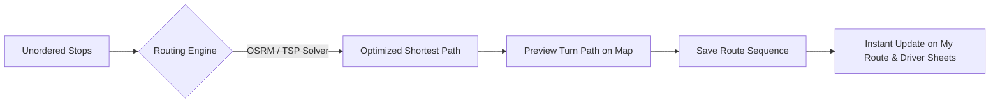

# Route Ordering & Traveling Salesperson Optimization

The **Route Ordering** tool (`/ordering`) eliminates route confusion and optimizes travel times by arranging bus stops in the most logical geographic order.

---

## 🧭 How Route Ordering Works

RouteApp provides two complementary ordering modes:
1. **Algorithmic TSP Optimization (1-Click Auto-Sort)**
2. **Manual Drag-and-Drop Sequencing**

---

## ⚡ 1-Click Algorithmic TSP Optimization

Under the hood, RouteApp runs a **Traveling Salesperson Problem (TSP)** heuristic algorithm:
1. Click **Optimize Route Order** at the top of `/ordering`.
2. Select your **Start Point** (e.g., Church Campus or Bus Depot).
3. Select your **End Point** (e.g., Church Campus or Final Stop).
4. Select Optimization Criteria:
   - **Shortest Drive Time (Duration)**
   - **Shortest Distance (Miles/Kilometers)**
   - **Avoid Left Turns / School Zones** *(Optional)*
5. Click **Calculate Optimal Sequence**.
6. The interactive map renders the proposed driving polyline with time and mileage savings.
7. Click **Apply Order** to save.

---

## 🖐️ Manual Drag-and-Drop Re-Ordering

If you have specific logistical requirements (e.g., a high school teen who needs early pickup, or picking up siblings across towns in a custom pattern):
1. In `/ordering`, grab any stop card by the **drag handle (`⋮⋮`)**.
2. Move it up or down in the sequence list.
3. The numbered badges (`1`, `2`, `3...`) re-index automatically.
4. Changes save instantly.

---

## 🌅 Morning Pickup vs. Afternoon Drop-Off Routes

RouteApp allows distinct ordering for morning and afternoon runs:
- **Morning Run (Pick-Up)**: Typically runs furthest outward stop first, finishing at church.
- **Afternoon Run (Drop-Off)**: Can automatically reverse the morning sequence or use a dedicated drop-off route order so younger children are dropped off first.
- Toggle between **Morning (Pickup)** and **Afternoon (Dropoff)** tabs at the top of `/ordering`.
