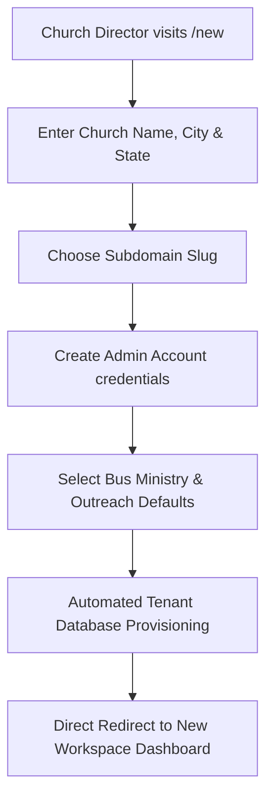

# Church Onboarding & Workspace Provisioning (/new & /onboard)

RouteApp provides an automated self-service onboarding engine (`/new` and `/onboard`) that provisions a church tenant in under 60 seconds.

---

## 🚀 The Onboarding Flow

---

## 📝 Onboarding Information Collected

1. **Church Organization Information**:
   - Church Full Name (e.g., *"First Baptist Church"*)
   - Physical City, State, Country
   - Main Church Phone Number
2. **Custom Workspace Subdomain**:
   - Slug check (e.g., `fbcspringfield` ➔ `https://fbcspringfield.routeapp.org`)
   - Real-time availability check against existing tenants
3. **Primary Administrator Credentials**:
   - Lead Pastor or Bus Director Name
   - Admin Email Address & Secure Password
4. **Starter Template Configuration**:
   - Pre-populate default bus routes (e.g. *Route 1, Route 2*)
   - Pre-load standard Sunday School departments and grade scales
   - Generate initial territory boundary around the church campus

---

## ⚡ Instant Provisioning

Upon submitting `/register-tenant`:
- Database schema migrations and tenant seeding execute in milliseconds.
- A welcoming email with getting-started guides and login details is dispatched.
- The administrator is authenticated and logged directly into their new church workspace.
