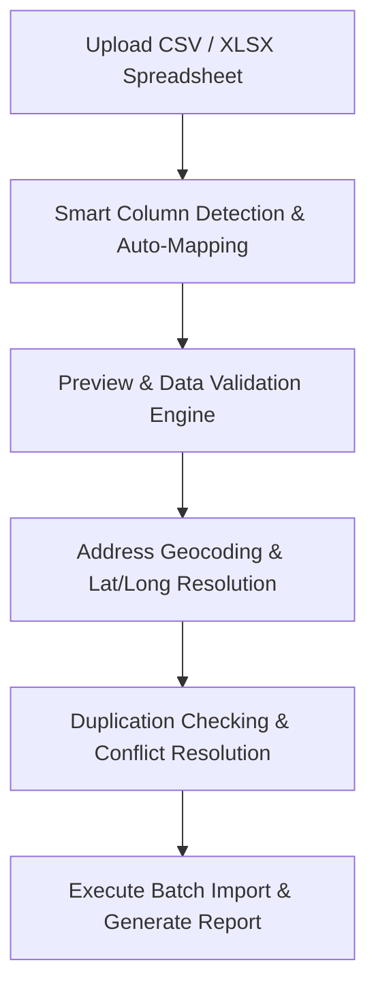

# Bulk Data Import & Smart Field Mapping

The **Bulk Import** tool (`/bulk-import` or `/import`) allows churches migrating from legacy databases, AppSheet apps, Google Sheets, or church management software (Planning Center, Breeze, Church Community Builder) to import thousands of records in minutes.

---

## 📥 Supported Data Entities

You can batch import:
- **Riders & Children Rosters**
- **Bus Stops & Household Addresses**
- **Prospects & Soulwinning Contacts**
- **Church Workers & Drivers**
- **Fleet Vehicles**

---

## ⚡ Step-by-Step Import Workflow

### Step 1: Upload Spreadsheet
- Drag and drop your `.csv` or `.xlsx` file onto `/bulk-import`.

### Step 2: Intelligent Column Mapping
- RouteApp automatically matches header names (e.g. `First_Name` ➔ `First Name`, `Street` ➔ `Address Line 1`, `Mom_Cell` ➔ `Guardian Phone`).
- Manually adjust any unmapped columns using the dropdown selectors.

### Step 3: Batch Geocoding & Validation
- RouteApp parses addresses and validates zip codes, states, and coordinates.
- Flagged rows (e.g., missing street name or invalid phone number) are highlighted in yellow for inline correction.

### Step 4: Execute & Review
- Click **Start Import**.
- A real-time progress bar tracks row insertion, auto-linking riders to households, and creating stops on their respective routes.
- Once finished, an import summary is generated for your records.
