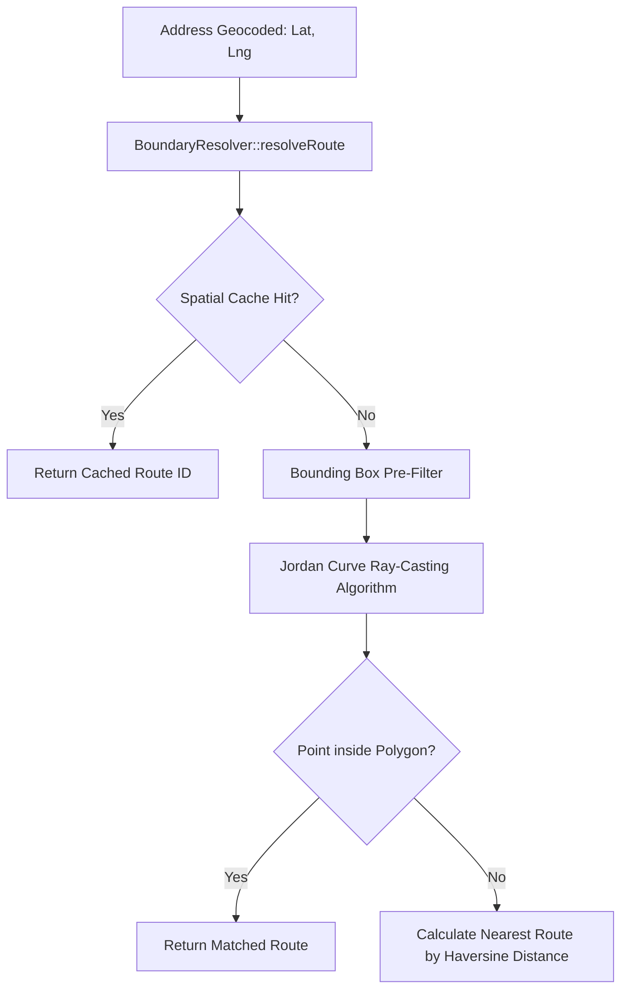

# Boundary Resolver & Geofencing Architecture

The `BoundaryResolver` service (`app/Services/BoundaryResolver.php`) is RouteApp's computational geometry engine. It performs point-in-polygon ray-casting, geofence sector indexing, and automated route boundary assignment.

---

## 📐 Computational Geometry: Point-in-Polygon (Ray-Casting)

When an address is geocoded to latitude and longitude coordinates $(x, y)$, `BoundaryResolver` determines which church route polygon or soulwinning sector encompasses the point:

### Ray-Casting Algorithm Logic
The Jordan curve theorem is implemented in PHP:
- A horizontal ray is cast from the target point $(P_x, P_y)$ extending infinitely to $+X$.
- For each edge between polygon vertices $(V_{1x}, V_{1y})$ and $(V_{2x}, V_{2y})$, RouteApp counts the number of intersections.
- An **odd count** indicates the point is inside the boundary; an **even count** indicates the point is outside.

---

## ⚡ Performance Optimization & Spatial Bounding Boxes

To ensure sub-millisecond route resolution:
1. **Axis-Aligned Bounding Box (AABB) Pre-Filter**:
   - Before running ray-casting on a 50-vertex polygon, RouteApp evaluates the bounding box:
   $$\text{Lat}_{\min} \le \text{Target}_{\text{Lat}} \le \text{Lat}_{\max} \quad \text{and} \quad \text{Lng}_{\min} \le \text{Target}_{\text{Lng}} \le \text{Lng}_{\max}$$
   - Non-overlapping polygons are discarded instantly.
2. **Spatial Hash Caching**:
   - Resolved coordinates are cached in Redis with spatial geohash keys (precision ~50 meters), eliminating repeated polygon calculations for identical streets.

---

## 🗺️ Fallback: Nearest Route via Haversine Distance

If an address falls outside all defined territory boundaries:
- `BoundaryResolver` falls back to the **Haversine formula** to calculate great-circle distances to all route centroids.
- It returns the closest active route with a proximity confidence score and flags the record for administrator review.
