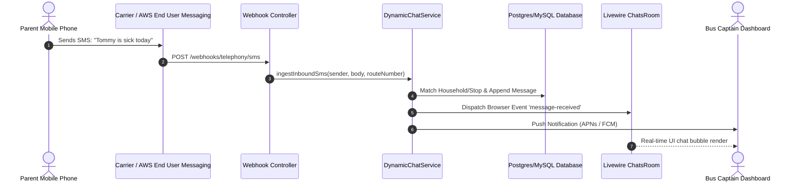

# Dynamic Chat Engine & SMS Bridging Architecture

The `DynamicChatService` (`app/Services/DynamicChatService.php`) and `TelephonyService` (`app/Services/Telephony/TelephonyService.php`) manage multi-channel messaging, bridging carrier SMS texts directly into real-time WebSockets and Livewire UI rooms.

---

## 🏗️ Message Pipeline & Architecture

---

## 🔍 Inbound SMS Ingestion & Household Matching

When an inbound SMS hits `TelephonyWebhookController@handleInboundSms`:
1. **E.164 Phone Normalization**: Strips non-numeric characters and formats to international E.164 (`+15552345678`).
2. **Virtual Number Scoping**: Identifies which tenant and bus route owns the receiving virtual number.
3. **Household / Stop Resolution**: Queries `Stop` and `Person` tables to associate the sender with a specific household.
4. **Thread Creation / Re-opening**: If an existing `SmsThread` exists, appends the message; otherwise, auto-creates a new thread tied to the Stop.
5. **Real-Time Notification Dispatch**:
   - Triggers Laravel Event: `InboundSmsReceived`
   - Broadcasts via Livewire event listener to update open browser tabs.
   - Triggers native Web Push / APNs push notifications to assigned workers.

---

## 📢 Outbound SMS & Mass Broadcast Throttling

When a captain sends a broadcast to 100 parents:
- Messages are processed asynchronously via Laravel Queue workers.
- Queue jobs respect carrier throughput constraints (e.g. 10 messages/second on standard 10DLC routes).
- Each outbound message stores carrier message ID (`aws_message_id`) for delivery receipt tracking.
