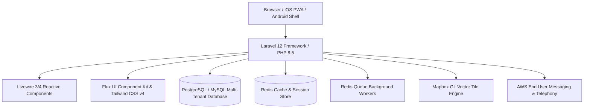

# Architecture & Technology Stack

RouteApp is engineered as a modern, high-performance, monolithic cloud application built on the Laravel ecosystem.

---

## 🛠️ Core Technology Stack

### 1. Backend Framework
- **PHP 8.5**: Modern PHP with strict types, constructor property promotion, match expressions, and enums.
- **Laravel 12**: Core application framework handling routing, Eloquent ORM, authentication, queue scheduling, and service providers.
- **Multi-Tenancy Engine**: Tenant scoping based on request subdomain (`{tenant}.routeapp.org`) and contextual database bindings.

### 2. Frontend & Reactive UI
- **Livewire**: Server-side reactivity delivering single-page application speed without the complexity of client-side state synchronization.
- **Alpine.js**: Lightweight client-side directives for micro-interactions, modal dialogs, and offline caching.
- **Flux UI**: Tailored modern UI component library.
- **Tailwind CSS v4**: Utility-first CSS engine.

### 3. Mapping, Geocoding & Routing
- **Mapbox GL JS**: WebGL vector tile rendering for high-resolution territory maps.
- **OSRM / Pelias / Mapbox Geocoders**: Forward address autocomplete and reverse geocoding.

### 4. Telephony & Communications
- **AWS End User Messaging (formerly Pinpoint SMS)**: 10DLC carrier-compliant SMS dispatch.
- **Amazon Chime / Twilio Voice SIP**: PSTN voice trunking and routing.
- **LiveKit**: WebRTC media server for browser-to-browser and browser-to-SIP softphone audio.
