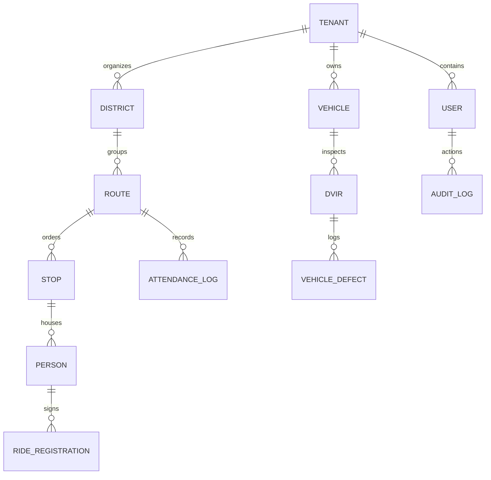

# Database Schema & Eloquent Models Reference

This document maps the primary Eloquent models and database relationships in RouteApp.

---

## 🗄️ Core Entity Relationship Diagram (ERD)

---

## 📋 Primary Eloquent Models (`app/Models`)

### 1. `Tenant` (`App\Models\Tenant`)
- **Table**: `tenants`
- **Description**: Represents an isolated church or ministry organization.
- **Relationships**: `hasMany(User::class)`, `hasMany(Route::class)`, `hasMany(Vehicle::class)`, `hasMany(District::class)`.

### 2. `User` (`App\Models\User`)
- **Table**: `users`
- **Description**: Church staff, captains, drivers, and soulwinners.
- **Key Traits & Methods**: `hasRole()`, `assignedRoutes()`, `passkeys()`, `activeDevices()`.

### 3. `Route` (`App\Models\Route`)
- **Table**: `routes`
- **Description**: A specific operational bus route with boundary polygon, assigned vehicle, and leadership team.
- **Relationships**: `belongsTo(District::class)`, `belongsTo(Vehicle::class)`, `hasMany(Stop::class)`, `hasMany(AttendanceLog::class)`.

### 4. `Stop` (`App\Models\Stop`)
- **Table**: `stops`
- **Description**: A physical household or pickup location along a bus route.
- **Key Fields**: `address_line1`, `latitude`, `longitude`, `sequence_order`, `driver_instructions`.
- **Relationships**: `belongsTo(Route::class)`, `hasMany(Person::class)`.

### 5. `Person` (Rider & Guardian) (`App\Models\Person`)
- **Table**: `people`
- **Description**: Individual children, teenagers, adult passengers, and guardians.
- **Relationships**: `belongsTo(Stop::class)`, `hasMany(PermissionSlip::class)`.

### 6. `Vehicle` & `Dvir` (`App\Models\Vehicle`, `App\Models\Dvir`)
- **Tables**: `vehicles`, `dvirs`, `vehicle_defects`
- **Description**: Fleet assets, daily pre/post-trip safety reports, and logged defects.
