# Bus Captain Sunday Morning Playbook

This operational playbook outlines the step-by-step procedure for Route Captains, Co-Captains, and Bus Workers from preparation through morning pickup, church arrival, and afternoon return.

---

## ⏰ Sunday Morning Timeline & Checklist

```mermaid
gantt
    title Sunday Morning Bus Ministry Timeline
    dateFormat HH:mm
    axisFormat %H:%M
    section Pre-Trip
    Captain & Worker Prayer :07:00, 15m
    Driver DVIR & Bus Inspection :07:15, 20m
    Route List & Attendance Init :07:35, 10m
    section Route Run
    Depart Depot :07:45, 10m
    Morning Pickups (Stops 1-15) :07:55, 65m
    Arrive at Church Campus :09:00, 15m
    section Service
    Sunday School & Church Services :09:15, 150m
    section Drop-Off
    Bus Boarding & Roll Call :11:45, 15m
    Afternoon Drop-Offs :12:00, 60m
    Depot Return & Child Safety Sweep :13:00, 20m
```

---

## 🌅 Phase 1: Pre-Trip Preparation (7:00 AM – 7:45 AM)

### 1. Worker Meeting & Prayer (7:00 AM)
- Meet at the church bus garage/depot.
- Pray for driver safety, child protection, and family salvation.
- Review any special notes on the route (new move-ins, first-time riders, medical alerts).

### 2. Launch RouteApp & Route Scoping (7:30 AM)
1. Mount the tablet in the bus cabin or open RouteApp on your phone.
2. Select your route using the **Active Route Switcher** in the top bar (e.g. `Route 3 - Eastside`).
3. Confirm with your driver that their **Pre-Trip DVIR Inspection** (`/vehicles/dvir`) has been completed and submitted.
4. Verify your phone battery is charged and cellular data is active.

---

## 🚌 Phase 2: Morning Route Run (7:45 AM – 9:00 AM)

### Stop-by-Stop Workflow:
1. **Approach Stop**: The driver navigates using the built-in 1-tap navigation.
2. **Stop Arrival**:
   - The bus stops safely at the designated curb with hazard flashers or amber lights engaged.
   - Look for waiting riders.
   - If children are not outside, send a quick **SMS arrival reminder** from `/chats` or tap **Call Guardian**.
3. **Boarding the Bus**:
   - Greet each child by name with enthusiasm and warmth.
   - Open `/attendance` and tap the child's card ➔ Turn badge 🟢 **Present (Boarded)**.
   - Ensure the child is safely seated before the bus pulls away.
4. **Walk-On Visitors**:
   - If a child brings a friend or neighbor who is not in the system:
   - Tap **+ Add Walk-On** in `/attendance`.
   - Enter Child Name, Age/Grade, Guardian Name, and Guardian Phone Number.
   - RouteApp automatically adds them to the live bus manifest and queues an SMS permission slip request to the parent.
5. **Marking Absentees**:
   - If a parent informs you the child is sick: tap the card to toggle 🟡 **Excused (Sick)**.
   - If no one answers after waiting: mark ⚪ **Absent (Not Home)**.

---

## ⛪ Phase 3: Church Campus Arrival (9:00 AM – 9:15 AM)

1. **Unloading**:
   - Escort younger children safely from the bus into the church building.
   - Guide children to their respective Sunday School classrooms (Beginners, Primary, Junior, Teens).
2. **Attendance Reconciliation**:
   - Check the top banner on `/attendance` to verify that the **Total Boarded Count** matches the physical headcount in the classrooms.
   - Download the official **PDF Bus Manifest** (`/attendance/{id}/pdf`) if required for church office records.

---

## 🏠 Phase 4: Afternoon Drop-Off (11:45 AM – 1:15 PM)

1. **Boarding & Verification**:
   - Re-assemble all riders at the bus departure zone.
   - Check off each child in the **Afternoon Drop-Off Roll Call**.
   - Confirm no children are missing before the bus wheels roll.
2. **Delivering Children Home**:
   - Stop at each household in the afternoon drop-off sequence (`/ordering`).
   - Ensure younger children (Nursery through 5th Grade) are received by an authorized parent or guardian at the door.
3. **Depot Return & Mandatory Child Safety Sweep (CRITICAL)**:
   - Once the bus is parked at the depot, the driver and captain **MUST** physically walk from the front of the bus to the very back row.
   - Check on top of and under every seat to guarantee no sleeping child or personal item remains onboard.
   - Complete the **Post-Trip DVIR Inspection** and sign off on the Child Safety Sweep confirmation.
