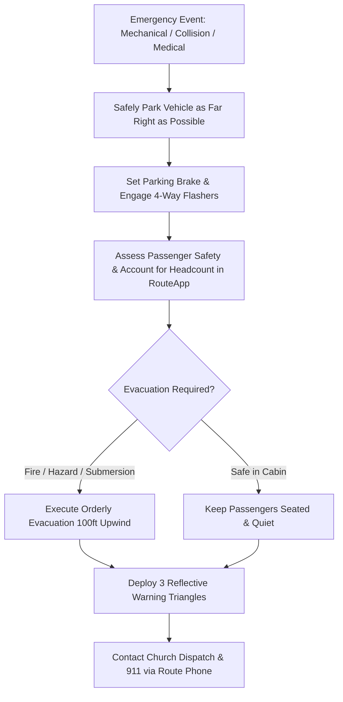

# Driver Safety & DOT Compliance Manual

This handbook establishes the safety standards, defensive driving protocols, regulatory DOT compliance, and emergency procedures for all church bus and van drivers using RouteApp.

---

## 📜 Driver Qualifications & Licensing Requirements

All church vehicle operators must maintain the following credentials on file in the **Workers Directory (`/workers`)**:

1. **Commercial Driver's License (CDL)**:
   - Required for vehicles designed to transport 16 or more passengers (including driver).
   - Valid **Passenger (P)** endorsement and **Air Brakes** endorsement (if vehicle uses pneumatic brakes).
2. **Current DOT Medical Examiner's Certificate**: (Form MCSA-5876).
3. **Valid Motor Vehicle Record (MVR)**: Free of major infractions (DUI, reckless driving, excessive speeding) within the past 36 months.
4. **Annual Church Driver Safety Training Certification**.

---

## 🛑 Daily Driver Safety Protocols

### 1. Pre-Trip Inspection (Mandatory)
- Never move a vehicle without submitting a completed **Pre-Trip DVIR (`/vehicles/dvir`)**.
- If any **Critical Defect (Red)** is discovered, do not operate the vehicle. Immediately contact the Fleet Mechanic or Dispatch.

### 2. Loading & Unloading Safety
- Always activate yellow hazard lights or school bus amber warning lights at least 100 feet prior to stopping.
- Engage red flashing lights and extend the stop-arm **only after the bus has come to a complete stop**.
- Place the transmission in Neutral/Park and set the parking brake before opening passenger entrance doors.
- Never back up the bus at a student pickup location while children are outside. If backing is unavoidable, use a bus worker ground guide.

### 3. Railroad Crossing Protocol
1. Activate 4-way hazard flashers 100 feet before the tracks.
2. Stop the bus between 15 and 50 feet from the nearest rail.
3. Open the driver window and passenger entrance door.
4. Turn off cabin heaters, radio, and quiet the bus riders: **Look and listen in both directions**.
5. Close the entrance door before proceeding smoothly across tracks without shifting gears.

---

## 🚨 Emergency Procedures & Breakdown Management

### Warning Triangle Placement:
- **Two-Way Road**: 1 triangle 10 feet behind bus, 1 triangle 100 feet behind bus, 1 triangle 100 feet ahead of bus.
- **Divided Highway / Interstate**: 1 triangle 10 feet behind bus, 1 triangle 100 feet behind bus, 1 triangle 200 feet behind bus.

---

## 🔒 Post-Trip Child Safety Sweep
- Upon returning to the bus barn, the driver is legally responsible for walking to the last row of seats to inspect every seat and floor board for sleeping children before signing off the **Post-Trip DVIR**.
