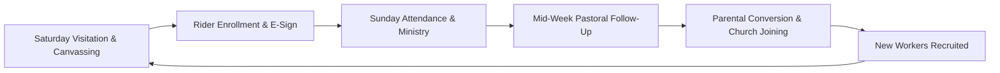

# Pastor & Bus Director Handbook

This handbook provides church pastors, executive leaders, and bus directors with strategic frameworks, ministry growth models, legal risk management practices, and administrative routines for operating a flourishing transportation and outreach ministry with RouteApp.

---

## 🏛️ Foundational Philosophy of the Bus Ministry

The church bus ministry is an evangelistic outreach pipeline designed to bring unchurched children, teens, and adults under the sound of the Gospel every week. 

### Key Pillars of a Fruitful Bus Ministry:
1. **Consistency**: Buses run every single Sunday rain or shine.
2. **Weekly Saturday Visitation**: A route that is not visited on Saturday will not see high attendance on Sunday.
3. **Child Safety & Protection**: Uncompromising vehicle safety standards, background checks, and digital permission slips.
4. **Parental Relationships**: Continuous two-way communication via Route Phone SMS and calls.

---

## 📈 Strategic Growth Cycle

---

## 🛡️ Legal Risk Management & Insurance Compliance

To protect your church organization from liability:
1. **Digital E-Sign Permission Slips (`/ride/sign/{id}`)**: Enforce 100% parental permission slip coverage for all transported minors. Never transport a child without a signed emergency medical waiver on file.
2. **Mandatory Background Screening**: Require background checks for every driver, captain, and worker in the **Workers Directory (`/workers`)** with annual re-checks.
3. **DOT / FMCSA Compliance**: Ensure all vehicles over 15 passengers undergo annual state inspections and drivers maintain current medical cards.
4. **Permanent Audit Trails (`/audit-logs`)**: Retain electronic timestamps and attendance records indefinitely for legal compliance.

---

## 📊 Executive Reporting & Board Dashboards

Every Monday morning, the Bus Director and Pastoral Team should review:
- **Fleet-Wide Headcount Total**: (`/attendance`)
- **Route Attendance Trends**: Identify top-performing routes and those needing worker reinforcement.
- **Defect Resolution Rate**: Confirm all DVIR issues logged on Sunday were triaged by mechanics in `/vehicles/mechanics`.
- **Spiritual Decisions & Baptisms**: Review converts logged during Saturday soulwinning in `/our-visits`.
