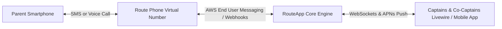

# Route Phone Overview & Telephony Architecture

**Route Phone** provides churches with dedicated, virtual phone numbers for each bus route and ministry department, protecting worker privacy and ensuring reliable two-way communication with parents and riders.

---

## 🏛️ Why Route Phone?

1. **Worker Privacy Protection**: Captains and drivers no longer need to give out their personal mobile numbers to hundreds of households.
2. **Ministry Continuity**: If a bus captain steps down, all message history, parent contacts, and incoming calls remain attached to the route, not lost on a personal device.
3. **Multi-Worker Shared Access**: Both the captain and co-captain can see and respond to incoming parent texts simultaneously.
4. **10DLC Regulatory Compliance**: Automated carrier registration through AWS End User Messaging ensures mass texts and reminders are not filtered or marked as spam by cellular carriers (AT&T, Verizon, T-Mobile).

---

## 📞 How Route Phone Handles Inbound & Outbound

### Inbound Calls
When a parent dials the route phone number:
1. RouteApp evaluates the configured **Ring Stage**:
   - **Simultaneous Ring**: Rings the browser/mobile softphones of all assigned captains and drivers.
   - **Sequential Cascade**: Rings the Primary Captain for 15 seconds; if unanswered, cascades to the Co-Captain; if unanswered, routes to the Church Main Office or Voicemail.
2. The caller hears a custom church greeting (e.g. *"Thank you for calling the Route 4 Bus Ministry..."*).

### Inbound SMS
When a parent sends a text:
1. The message appears in real time in the **Chats Room (`/chats`)**.
2. Push notifications alert on-duty captains.
3. Any authorized worker can reply instantly.
