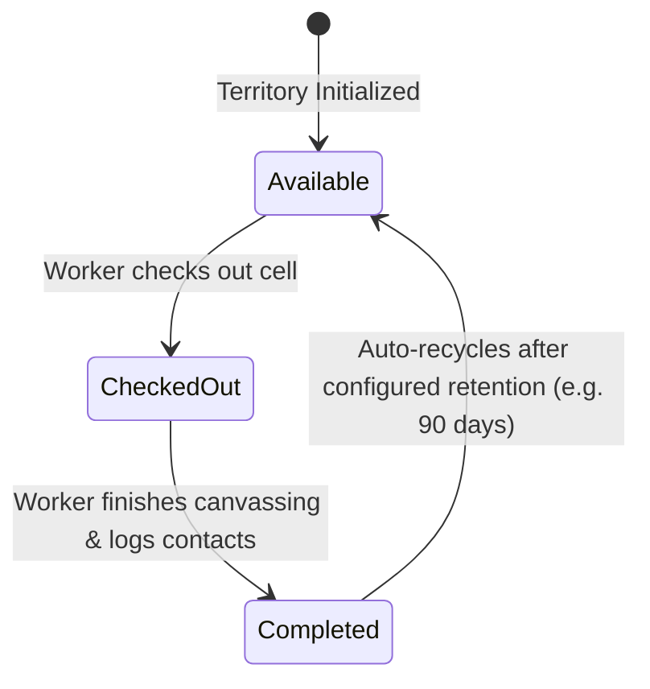

# Map Assignments & Territory Checkout

The **Map Assignments** manager (`/maps/assignments`) brings digital accountability and organization to church outreach by managing the checkout and check-in of neighborhood territory blocks.

---

## 🗺️ How Territory Checkout Works

Traditionally, churches use physical wooden boards or laminated map cards. In RouteApp:
1. Church territory is divided into structured **Grid Cells / Blocks** (e.g. `Cell #104 - Oak St to Pine St`).
2. Each cell has a status:
   - ⚪ **Available (Not Worked Recently)**
   - 🟡 **Checked Out (Currently Being Worked)**
   - 🟢 **Completed (Worked Within Last 30/60/90 Days)**
   - 🔴 **Restricted / Do Not Knock**

---

## 🚀 The Checkout Workflow

### 1. Worker Self-Checkout (Mobile)
1. On the map or assignment list, select an **Available** territory cell.
2. Tap **Check Out This Territory**.
3. Select your soulwinning partner from the active workers list.
4. The cell turns yellow across all church maps, letting everyone know this area is currently being canvassed.

### 2. Coordinator Direct Assignment
1. Outreach directors can open `/maps/assignments`.
2. Multi-select available cells.
3. Assign them in batches to specific partnerships or Bible college teams.

---

## 🏁 Check-In & Completion

When the partnership finishes knocking their assigned streets:
1. Tap **Check In / Complete Territory**.
2. RouteApp displays a quick summary modal:
   - *Total Doors Knocked*
   - *Gospel Presentations Given*
   - *Decisions / Salvations Recorded*
   - *New Bus Prospects Added*
3. Tap **Submit Completion**.
4. The cell turns green and logs the completion timestamp and worker credits in the church outreach history.
