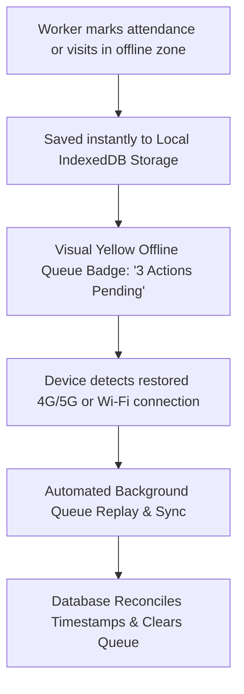

# Offline Data Caching & Cellular Sync Recovery

RouteApp incorporates an offline-first data caching layer powered by **Browser Service Workers** and **IndexedDB**, allowing captains and drivers to record attendance and view stops even in rural dead zones with zero cell service.

---

## 📶 How Offline Caching Works

---

## ⚡ Handling Sync Conflicts

If two workers mark the same child or household while operating in separate offline dead zones:
1. **Timestamp-Based Last-Write-Wins**: RouteApp compares the exact millisecond UTC timestamp recorded when the button was pressed on the physical device.
2. **Deterministic Merging**: If Worker A adds a contact note and Worker B marks the child present, both changes are merged without overwriting each other.
3. **Sync Indicator**: When cellular connection resumes, the yellow offline indicator turns green: *"All changes synchronized to cloud"*.

---

## 🛠️ Force Syncing or Resetting Cache

If you suspect local cached data is out of sync with the church database:
1. Ensure your phone or tablet is connected to high-speed church Wi-Fi or strong cellular.
2. Navigate to `/settings/appearance` or click your profile menu.
3. Tap **🔄 Clear Local Cache & Re-Sync Data**.
4. RouteApp purges stale local IndexedDB tables and downloads fresh snapshots of all stops, riders, and route geometries.
